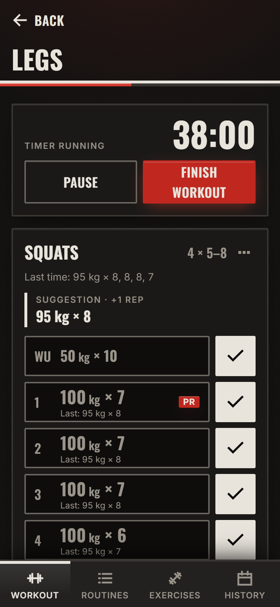
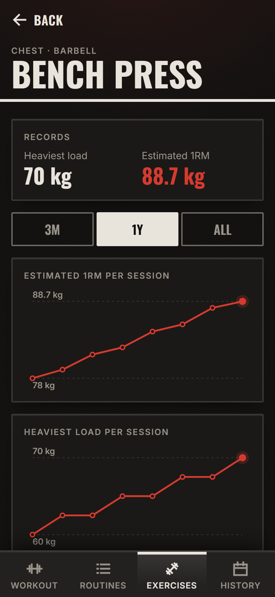
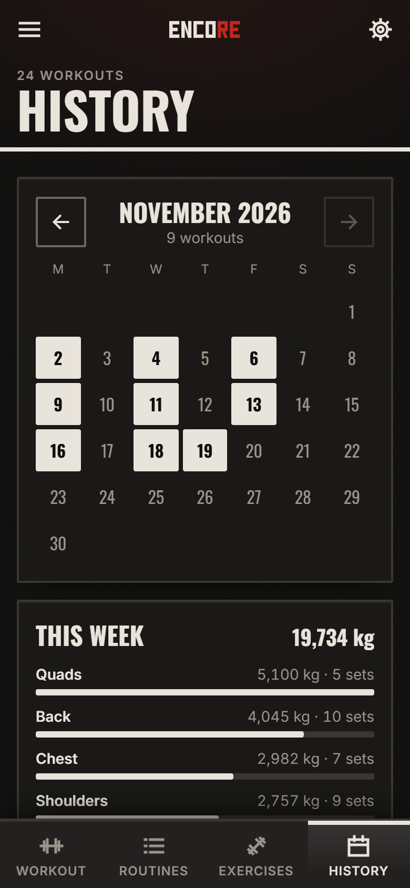

# Encore

[](https://github.com/nICOLAS-user15/Encore/actions/workflows/ci.yml)
[](LICENSE)

A strength-training log built for **the phone, mid-set and with no signal**.

Encore is a PWA: it installs on the home screen (Android and iOS), opens full screen and works 100% offline. There is no server and no account: all data stays on the device.

**Try it:** [encore-nine-zeta.vercel.app](https://encore-nine-zeta.vercel.app). Open it on your phone and add it to the home screen.

<p align="center">
  
  
  
</p>

## Features

- **Active workout:** start from a routine or train freely; every set comes pre-filled with the last time. Workout timer with pause, and automatic rest between sets.
- **Progression:** load suggestions through double progression, using each equipment's load step.
- **Personal records:** a set that beats your heaviest load or your estimated 1RM (Epley) gets a PR badge the moment you complete it.
- **Routines and splits:** build splits (Upper/Lower, PPL, ABC...) with their routines, sets, rep ranges and per-exercise rest.
- **Exercises:** a library of about 100 exercises, accent-insensitive search and custom exercises.
- **History:** duration, sets and volume for every workout, compared with the previous time, plus this week's volume by muscle group. Finished workouts can be corrected set by set.
- **Progress:** each exercise has its own screen with personal bests and charts of the estimated 1RM and the heaviest load, session by session.
- **Undo and backup:** deletions can be undone; export and import your data as a file to switch devices.
- **Portuguese and English**, screen kept on during a workout and a sound when rest is over.

## Stack

React 19 · TypeScript (`strict`) · Vite · Tailwind CSS v4 · React Router · Dexie (IndexedDB) · `vite-plugin-pwa` · Vitest + Testing Library · Playwright.

## Getting started

Requirements: Node 22 and [pnpm](https://pnpm.io).

```bash
pnpm install
pnpm dev       # development server
pnpm test      # unit and screen tests
pnpm e2e       # end-to-end tests (Playwright), including offline mode
pnpm lint      # ESLint + Prettier
pnpm build     # production build (generates the service worker)
pnpm preview   # serves the build: offline mode only works here
```

To publish and install on a phone, see [docs/INSTALLATION.md](docs/INSTALLATION.md).

## Documentation

- [Install and use on your phone](docs/INSTALLATION.md): deploying to Vercel, installing, backup and common problems.
- [Technical decisions and design](docs/DECISIONS.md): offline-first, a schema ready for sync, migrations, i18n, the design system.
- [CHANGELOG.md](CHANGELOG.md): what changed in each version.
- [CLAUDE.md](CLAUDE.md): project rules for anyone (or anything) changing the code.

## Structure

```
src/
  app/        router, layout, menu and the animated entrance
  features/   one folder per area (workout, routines, splits, exercises, history, settings)
  db/         Dexie schema, migrations, repository and seed
  i18n/       Portuguese and English texts
  ui/         base components and theme
  lib/        pure functions
```

## Roadmap

- [ ] Edit and delete custom exercises
- [ ] Unit preference (kg/lb)
- [ ] Account and sync between devices

## Privacy and security

The app makes no network requests other than downloading itself, and it collects no data. The backup file is plain text (not encrypted): keep it like any personal data. To report a vulnerability, see [SECURITY.md](SECURITY.md).

## License

[MIT](LICENSE)
